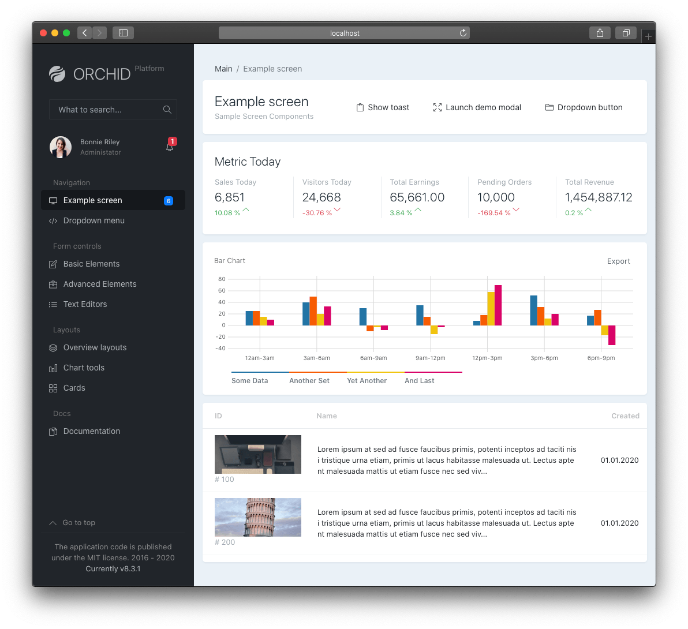

<p align="center"> 
 <a href="https://orchid.software/"></a>
</p>

<h4 align="center">For the full documentation, visit <a href="http://orchid.software">orchid.software</a>.</h4>

Orchid is a free [Laravel](https://laravel.com) package that abstracts standard business logic and allows code-driven rapid application development of back-office applications, admin panels, user panels, and dashboards.

<p align="center">
<a href="https://github.com/orchidsoftware/platform/actions"></a>
<a href="https://github.com/orchidsoftware/platform/actions/workflows/coverage.yml"></a>
<a href="https://packagist.org/packages/orchid/platform"></a>
<a href="https://opencollective.com/orchid"></a>
</p>

### Interesting Features

- **Rapid Application Development** - Focus on PHP development and don't lose time with HTML, CSS, or JavaScript. Build application logic, not admin panels. Try the [quick start guide](https://orchid.software/en/docs/quickstart/) and kick-start the application's development.

- **Form Builder** - Prevent reinventing the wheel or forms. Orchid already supports many [form elements](https://orchid.software/en/docs/field/) "out of the box" and allows building all kinds of forms quickly.

- **Fast Loading Times** - Enjoy an SPA like performance! Transitions can be made without reloading a page and require no additional code. Thanks to the [Hotwire](https://hotwire.dev/) project, Orchid makes this a satisfying experience for both users and developers.

- **Access Permissions & Roles** - Take advantage of [access permissions](https://orchid.software/en/docs/access/), based on a user’s identity and corresponding role membership.

- **Filtering & Sorting** - Offer users the ability to filter and sort data quickly! Orchid uses an [Eloquent based filtering/sorting approach](https://orchid.software/en/docs/quickstart-sort-filter-table/).

- **Fast Full-Text Search** - Take advantage of the integrated [Laravel Scout based full-text search](https://orchid.software/en/docs/global-search/), which allows searching through all available content and displaying search results almost instantly.

- **Multiple Notifications Types** - Orchid offers [various types of notifications](https://orchid.software/en/docs/alert/) and allows the application to keep users informed appropriately.

<!--
https://github.com/orgs/orchidsoftware/discussions/2649
### Live Demo

<a href="https://demo.orchid.software/login">
  
</a>

Curious but not (yet) in the mood to read the documentation? Click [here](https://demo.orchid.software/login), to experience a live demo of Orchid.

-->

<!--
## Getting started

### Documentation

* 🌍 [Documentation & Quick Start Guide](https://orchid.software/en/docs)
* 🇷🇺 Чтобы ознакомиться с руководством, посетите сайт [orchid.software](https://orchid.software/ru/docs)


### Blog

Orchid's [blog](https://blog.orchid.software/) informs about news and announcements around Laravel Orchid, including related projects.
-->

## Development checks

Run these commands from the package root:

```sh
composer install
vendor/bin/phpstan analyse --memory-limit=3G
vendor/bin/rector process --dry-run
vendor/bin/phpunit --no-coverage
```

PHPStan uses level 3 with Larastan, Carbon, and PHPUnit extensions. It checks source code, tests, configuration, database files, routes, and application stubs. Testbench loads Orchid's provider and authentication model from `testbench.yaml` so the analyser can resolve routing macros and model capabilities. Targeted exceptions and their reasons are documented in `phpstan.neon`.

### Workbench application

Workbench loads the shipped screens and routes directly from `stubs/app`, with test screens from `tests/App`. Providers and migrations are registered in `testbench.yaml`; running `orchid:install` is only necessary when testing the installer itself.

To run the development application:

```sh
vendor/bin/testbench workbench:build
vendor/bin/testbench migrate
vendor/bin/testbench orchid:admin
vendor/bin/testbench serve --host=127.0.0.1 --port=8001
```

Open `http://127.0.0.1:8001/dashboard`. This uses Testbench's disposable SQLite database inside `vendor`. Main tests use a separate in-memory database, transactions, and enabled foreign keys. Database setup is deferred until the first query or transaction in each test. Vite is disabled for Main tests, so they do not need published assets.

### Browser tests

Dusk uses its own file-backed SQLite database, shared with the browser server. It runs and rolls back migrations for each test. Install Google Chrome, then run:

```sh
vendor/bin/testbench-dusk workbench:build
vendor/bin/dusk-updater detect --auto-update
CI=true vendor/bin/phpunit --testsuite Browser --no-coverage
```

`CI=true` runs Chrome headlessly. Dusk serves the published assets from `public`; after changing JavaScript or Sass, run `npm install && npm run build` and rebuild Workbench. Failure screenshots, browser logs, and page sources are saved under `tests/Browser` and ignored by Git.

## Community

Continually striving to actively include feedback from the community in the development of Orchid greatly benefits its progress.
Support from the community is invaluable when providing well-structured and detailed feedback.

### GitHub

Create [issues](https://github.com/orchidsoftware/platform/issues) to report problems or participate in [discussions](https://github.com/orchidsoftware/platform/discussions) to ask questions, share ideas, and give opinions.

### Telegram User Groups

Join the [Global Community](https://t.me/orchid_community), [Russian Community](https://t.me/orchid_russian_community), or [Spanish Community](https://t.me/esLaravelOrchid) on Telegram.

### Discord

Join the [Discord](https://discord.gg/NxXhSHa5tq) server to chat with other Orchid users and the development team.

## Support Orchid

Thanks to the support of backers 🙏, Orchid is now available for both private and commercial purposes, free of charge. 🎉
Voluntary donations enable the team to allocate more time towards improving Orchid for the benefit of all users! 👍

<a href="https://opencollective.com/orchid#backers" target="_blank"></a>
<a href="https://opencollective.com/orchid#backers" target="_blank"></a>

## License

The MIT license covers Orchid. Check [the license](LICENSE) for further information.
